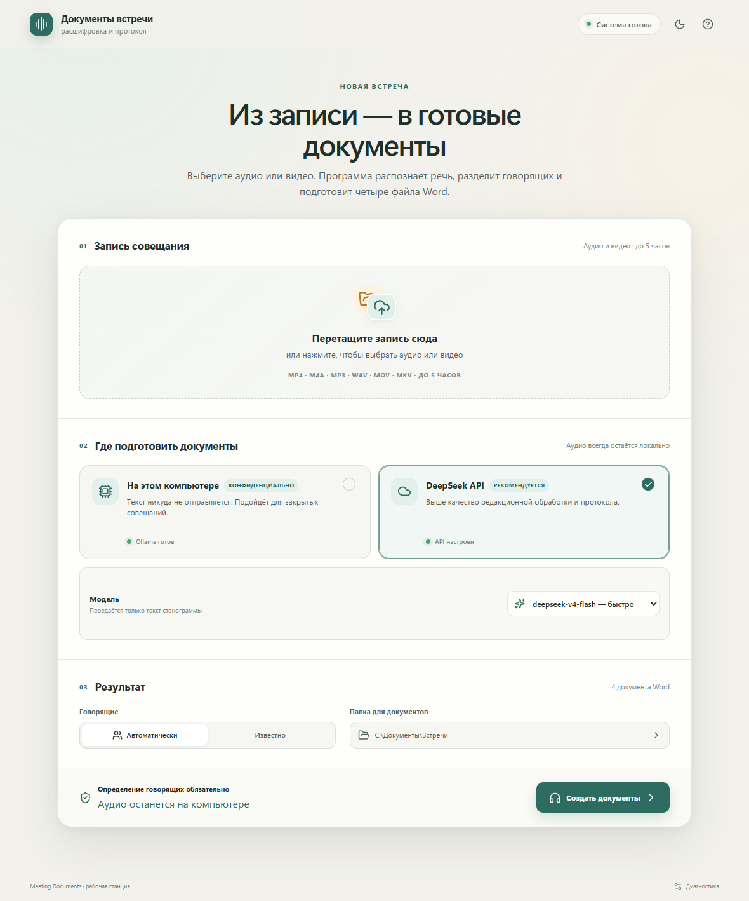
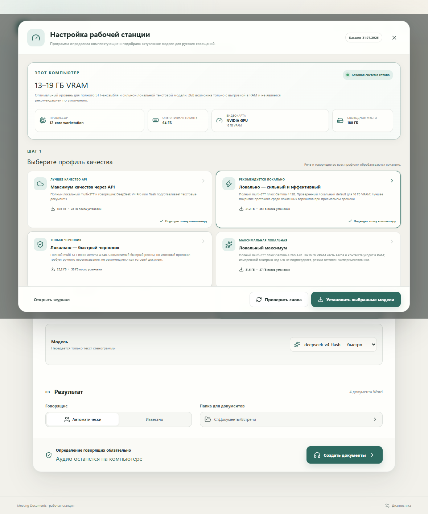
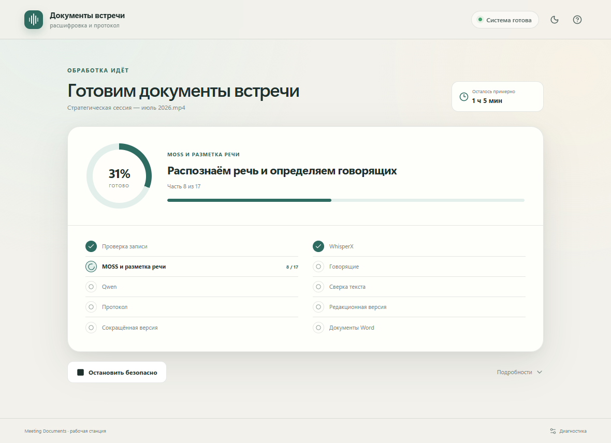
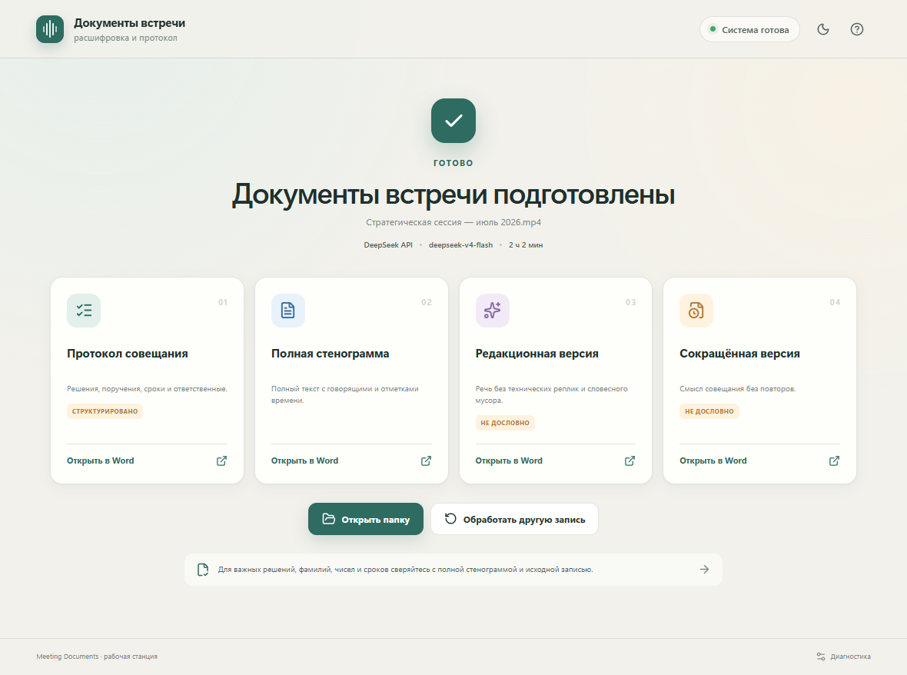
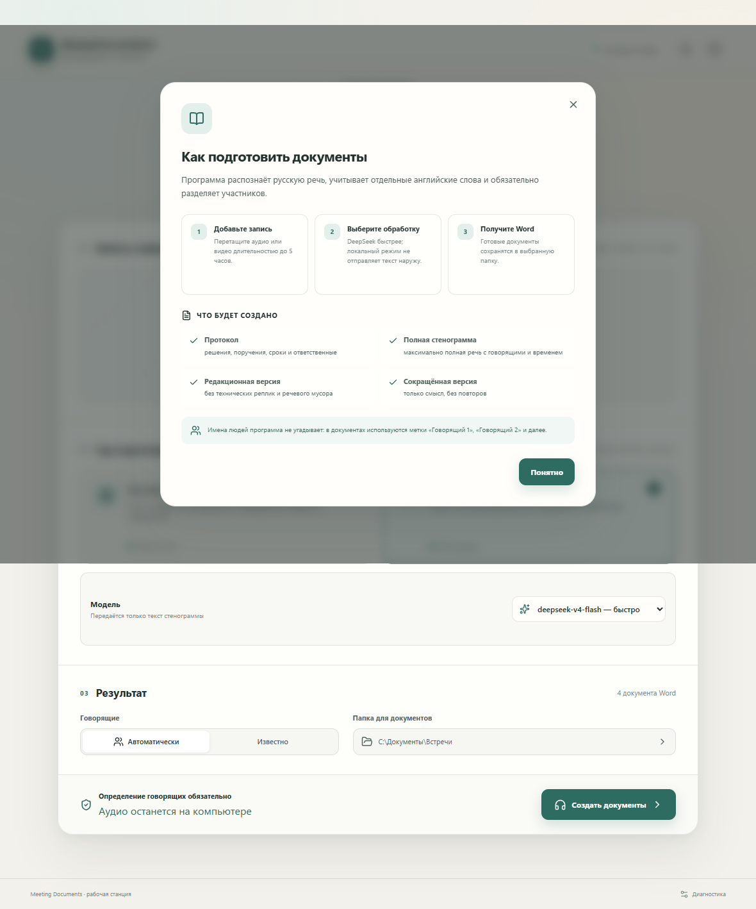
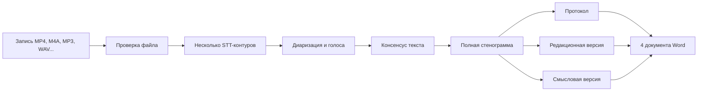

# Документы встречи

> Русскоязычное Windows-приложение, которое превращает запись совещания в
> точную стенограмму с говорящими и четыре аккуратно оформленных документа Word.


## Что вы получите

Программа принимает аудио или видео совещания длительностью до пяти часов,
определяет говорящих и создаёт четыре результата:

| Файл | Для чего он нужен |
| --- | --- |
| **Протокол совещания** | Решения, задачи, ответственные, сроки и открытые вопросы |
| **Полная стенограмма** | Максимально близкий к исходной речи текст с таймкодами и говорящими |
| **Редакционная стенограмма** | Читаемая версия без «вас слышно», повторов-паразитов и технического шума |
| **Сокращённая смысловая стенограмма** | Короткий вариант только с существенными высказываниями |

Определение говорящих является обязательной частью финального конвейера. Если
имена людей неизвестны, программа использует устойчивые метки «Говорящий 1»,
«Говорящий 2» и так далее.

## Быстрый старт для пользователя

Готовый установщик находится в [папке релиза](release/MeetingDocuments-0.1.12-win-x64/).
Также можно скачать единый архив:

[**Скачать ZIP-архив для Windows**](release/MeetingDocuments-0.1.12-win-x64.zip)

1. Распакуйте архив.
2. Запустите `Документы встречи_0.1.12_x64-setup.exe`.
3. В мастере выберите рекомендуемый профиль и дождитесь установки компонентов.
4. Перетащите запись в окно или нажмите «Выбрать запись».
5. Оставьте автоматическое определение говорящих, выберите папку результата и
   нажмите «Создать документы».
6. После завершения откройте любой из четырёх DOCX прямо из финального экрана.

Первый запуск требует интернет, права администратора и свободное место для
WSL и моделей. Для локального профиля Gemma 12B ориентируйтесь примерно на 22 ГБ
загрузок и 40 ГБ свободного места после установки. Уже установленные компоненты
повторно не скачиваются.

## Как выглядит приложение

### Главное окно



Здесь пользователь видит запись, режим обработки, модель, параметры говорящих и
папку, куда будут сохранены документы.

### Мастер подготовки компьютера



Мастер сам проверяет WSL2, CUDA, FFmpeg, Ollama, Python-среды и подходящий набор
моделей. Профиль выбирается по VRAM, RAM и свободному диску.

### Обработка и прогресс



Длинная запись разбивается на контрольные этапы. При перезапуске программа может
продолжить работу с последней сохранённой точки.

### Готовые документы



Финальный экран показывает четыре DOCX, их расположение и кнопку открытия папки.

### Справка



Встроенная справка объясняет режимы приватности, назначение каждого документа и
смысл обязательной диаризации.

## Как устроен конвейер



Подробное описание этапов, контрольных точек и детерминированных частей находится
в [архитектуре](docs/АРХИТЕКТУРА.md).

## Локальный режим и DeepSeek

### Локально — по умолчанию для конфиденциальных встреч

Аудио, видео, стенограмма и документы остаются на компьютере. В качестве основного
локального редактора используется Gemma 4 12B. Интернет нужен только для первого
скачивания компонентов и моделей.

### DeepSeek API — опционально

DeepSeek V4 Flash даёт наиболее сильную редакторскую обработку из проверенных
вариантов. Аудио и видео не отправляются: при явном подтверждении наружу уходит
только текст стенограммы. В репозитории и установщике нет API-ключа.

Чтобы включить этот режим, администратор задаёт собственную пользовательскую
переменную Windows `DEEPSEEK_API_KEY` и перезапускает программу. Без ключа карточка
DeepSeek отключена, а приложение автоматически остаётся в локальном режиме.

Подробнее о границах данных: [Приватность и данные](docs/БЕЗОПАСНОСТЬ_И_ДАННЫЕ.md).

## Какие модели выбрать

| Вариант | Когда выбирать | Ограничение |
| --- | --- | --- |
| **Gemma 4 12B** | Лучший локальный баланс качества и скорости на 16 ГБ VRAM | Нужны мощная видеокарта, RAM и первый скачок моделей |
| **DeepSeek V4 Flash** | Максимально аккуратный протокол, если допустима отправка текста | Нужен собственный API-ключ и согласие на передачу текста |
| **Gemma 4 e4b** | Быстрый черновик | Чаще упрощает и теряет детали, не основной финальный профиль |
| **Gemma 4 26B** | Эксперимент на машине с большим запасом RAM | Медленнее; устойчивого выигрыша над 12B в текущем сравнении нет |

Полная матрица моделей и требований: [Модели и профили](docs/МОДЕЛИ_И_ПРОФИЛИ.md).

## Требования к компьютеру

- Windows 10 или Windows 11, x64;
- NVIDIA GPU с CUDA — практический минимум зависит от выбранного профиля;
- для рекомендуемого локального профиля: около 16 ГБ VRAM и 48–64 ГБ RAM;
- около 40 ГБ свободного места после установки локального профиля;
- интернет на первом запуске для WSL и загрузки выбранных моделей;
- права администратора для установки системных компонентов.

Мастер умеет оценивать ноутбуки, обычные рабочие станции, профессиональные
конфигурации и серверные классы. VRAM нескольких видеокарт не складывается в один
единый «виртуальный» бюджет.

## Важные свойства

- русский язык — основной, английские имена и технические слова сохраняются;
- таймкоды полной стенограммы не переписываются редактором;
- говорящие обязательны, а не являются дополнительной опцией;
- четыре DOCX создаются автоматически, без ручного копирования текста;
- фоновые PowerShell, Python и WSL-процессы запускаются без видимых терминальных окон;
- сбой или перезагрузка не стирают уже созданные контрольные точки;
- локальный режим не требует DeepSeek и может работать без внешнего API.

## Для разработчика

Проект состоит из Tauri 2 + React/TypeScript интерфейса и Python-конвейера.
В `vendor/MOSS-Transcribe-Diarize` лежит обычная копия исходников MOSS, поэтому
обычный `git clone` не требует отдельного submodule checkout.

```powershell
cd apps/desktop
npm install
npm run check
npm run test:ui
npm run tauri:build:full
```

Python-тесты запускаются из корня проекта:

```powershell
python -m pytest -q
```

Готовый NSIS-установщик появляется в
`apps/desktop/src-tauri/target/release/bundle/nsis/`, а скрипт
`scripts/Build-PublicRelease.ps1` формирует папку и ZIP публичного релиза.

## Навигация по репозиторию

| Раздел | Содержание |
| --- | --- |
| `apps/desktop` | Пользовательский Windows-интерфейс |
| `meeting_transcriber` | Python-конвейер, задания и документы |
| `installer` | Проверка компьютера, WSL, окружения и моделей |
| `scripts` | STT, консенсус, очистка стенограммы и оценки |
| `tests` | Контрактные, Unicode, установочные и pipeline-тесты |
| `vendor` | Исходники MOSS и его лицензия |
| `release` | Готовый установщик для Windows |
| `docs` | Русские схемы, пояснения и матрица моделей |

## Лицензии

Исходный код приложения распространяется по [MIT License](LICENSE). Лицензии
MOSS, WhisperX, Qwen, Gemma, ECAPA, Ollama и условия DeepSeek остаются отдельными:
[уведомления о сторонних компонентах](THIRD_PARTY_NOTICES.md).

---

Проект рассчитан на офисного сотрудника: выбрать запись, дождаться обработки и
получить готовые документы Word без необходимости знать PowerShell, WSL, JSON или
команды языковых моделей.