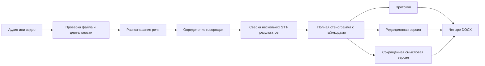

# Как работает «Документы встречи»

Приложение разделяет работу на независимые этапы. Это позволяет видеть прогресс,
повторно запустить прерванное задание и не потерять полную стенограмму, если
позже создаются сокращённые версии.

## Что происходит на этапах

1. **Проверка.** Программа принимает MP4, M4A, MP3, WAV, MOV, MKV, AAC, FLAC,
   OGG и WebM. Длина одной записи — до пяти часов.
2. **STT.** Для русской речи используются несколько независимых распознающих
   контуров. Отдельные английские имена, команды и технические термины не
   переводятся автоматически.
3. **Говорящие.** Диаризация обязательна для финальной стенограммы. Если имена
   людей неизвестны, используются устойчивые метки «Говорящий 1», «Говорящий 2».
4. **Консенсус.** Один результат является якорем таймкодов и говорящих. Другие
   результаты используются только для уточнения текста в тех же временных
   пределах. Модель не может переписать таймкод или заменить говорящего.
5. **Документы.** Из проверенной стенограммы создаются четыре версии с разной
   степенью редакторского сокращения.

## Где детерминизм, а где модель

Детерминированы проверка формата, ограничение длительности, маршрутизация
файлов, сохранение таймкодов якоря, обязательность диаризации, имена выходных
файлов и контроль наличия четырёх документов. Стохастичны распознавание речи,
выбор формулировки при расхождении STT и редактура текста языковой моделью.

Каждое задание сохраняет статус, контрольные точки и журнал. Поэтому сбой
загрузки или перезагрузка не требуют начинать длинную запись с нуля.